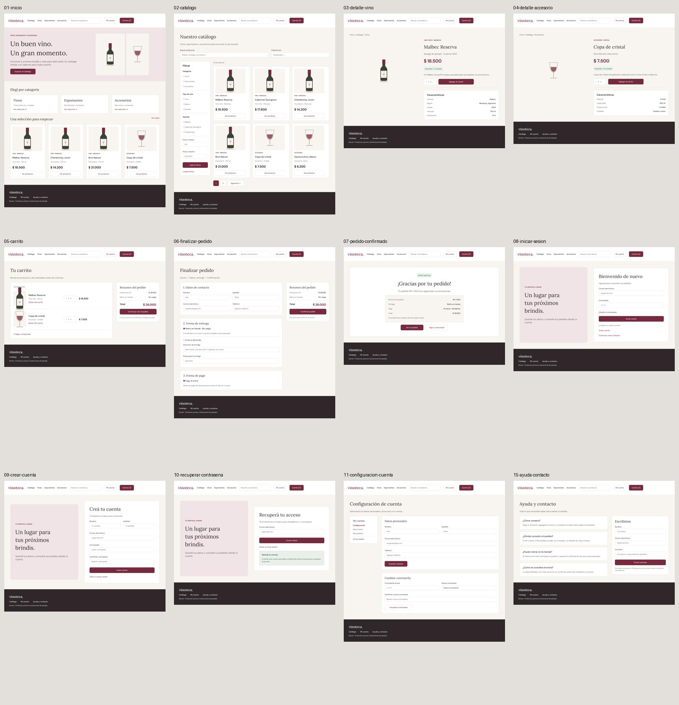

# Bocetos de la vinoteca

Los bocetos editables están en [Vinoteca · Bocetos principales](https://www.figma.com/design/SkLhTgi4i22kRbrJtTWN4w?node-id=3-3).

Esta carpeta conserva una copia visual de las **12 pantallas con contenido**, exportada el **17 de octubre de 2026**. Los PNG son imágenes estáticas; las capas, los componentes y los enlaces del prototipo se editan en el archivo de Figma. No se incluye un archivo nativo `.fig`. Esta copia no se sincroniza automáticamente con Figma.

Los bocetos son una propuesta de interfaz. Los productos, precios, ilustraciones y datos de ejemplo no constituyen requisitos definitivos ni funcionalidad implementada.

## Vista general

## Pantallas exportadas

| Pantalla | Copia local | Original editable |
| --- | --- | --- |
| Inicio | [PNG](png/01-inicio.png) | [Abrir en Figma](https://www.figma.com/design/SkLhTgi4i22kRbrJtTWN4w?node-id=3-3) |
| Catálogo y búsqueda | [PNG](png/02-catalogo.png) | [Abrir en Figma](https://www.figma.com/design/SkLhTgi4i22kRbrJtTWN4w?node-id=3-4) |
| Detalle de vino | [PNG](png/03-detalle-vino.png) | [Abrir en Figma](https://www.figma.com/design/SkLhTgi4i22kRbrJtTWN4w?node-id=3-5) |
| Detalle de accesorio | [PNG](png/04-detalle-accesorio.png) | [Abrir en Figma](https://www.figma.com/design/SkLhTgi4i22kRbrJtTWN4w?node-id=3-6) |
| Carrito | [PNG](png/05-carrito.png) | [Abrir en Figma](https://www.figma.com/design/SkLhTgi4i22kRbrJtTWN4w?node-id=3-7) |
| Finalizar pedido | [PNG](png/06-finalizar-pedido.png) | [Abrir en Figma](https://www.figma.com/design/SkLhTgi4i22kRbrJtTWN4w?node-id=3-8) |
| Pedido confirmado | [PNG](png/07-pedido-confirmado.png) | [Abrir en Figma](https://www.figma.com/design/SkLhTgi4i22kRbrJtTWN4w?node-id=3-9) |
| Iniciar sesión | [PNG](png/08-iniciar-sesion.png) | [Abrir en Figma](https://www.figma.com/design/SkLhTgi4i22kRbrJtTWN4w?node-id=3-12) |
| Crear cuenta | [PNG](png/09-crear-cuenta.png) | [Abrir en Figma](https://www.figma.com/design/SkLhTgi4i22kRbrJtTWN4w?node-id=3-13) |
| Recuperar contraseña | [PNG](png/10-recuperar-contrasena.png) | [Abrir en Figma](https://www.figma.com/design/SkLhTgi4i22kRbrJtTWN4w?node-id=3-14) |
| Configuración de cuenta | [PNG](png/11-configuracion-cuenta.png) | [Abrir en Figma](https://www.figma.com/design/SkLhTgi4i22kRbrJtTWN4w?node-id=3-15) |
| Ayuda y contacto | [PNG](png/15-ayuda-contacto.png) | [Abrir en Figma](https://www.figma.com/design/SkLhTgi4i22kRbrJtTWN4w?node-id=3-10) |

La numeración conserva la de los marcos originales de Figma; por eso hay un salto entre 11 y 15.

## Pendientes de diseño

Estas pantallas tienen únicamente marcos vacíos en Figma y no se exportaron como bocetos terminados:

- Direcciones, mis pedidos y detalle de mi pedido.
- Administración: resumen, gestión de productos, formulario de producto, gestión y detalle de pedidos, y configuración de tienda.
- Adaptaciones móviles: inicio, catálogo y carrito.

La creación de esos bocetos quedó interrumpida por el límite de operaciones de la conexión de Figma en el plan Starter. Esta exportación conserva el trabajo existente; no completa las pantallas pendientes.

## Archivos

- `png/`: exportaciones individuales a escala 1×.
- `vista-general.jpg`: vista conjunta para revisar las doce pantallas.
- `manifest.json`: identificadores de origen, dimensiones y sumas SHA-256 de las exportaciones.
